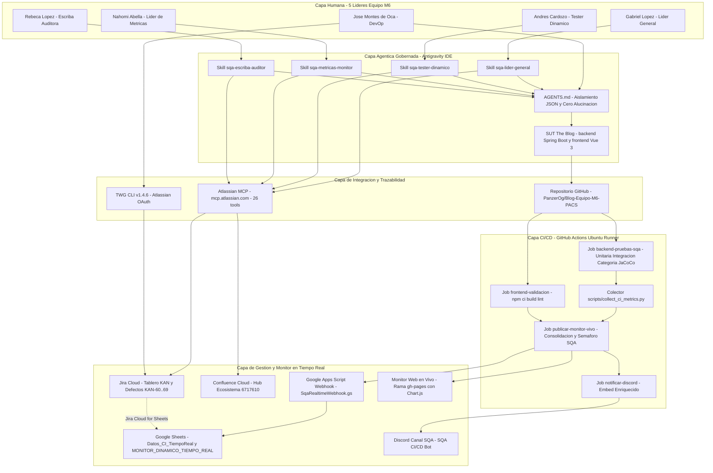
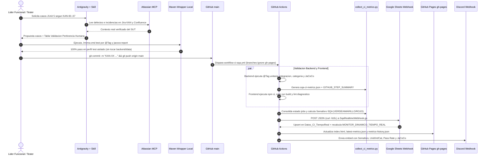
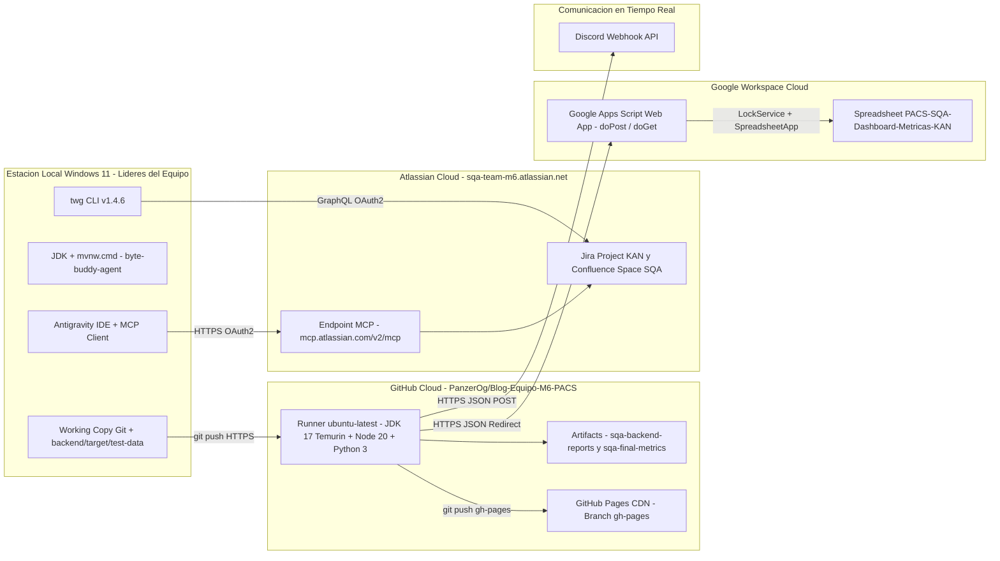
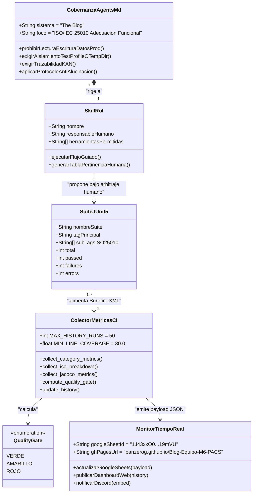

# Arquitectura UML del Ecosistema Tecnológico y Agéntico SQA

| Metadato ISO/IEC/IEEE 15289 | Valor |
| :--- | :--- |
| **Proyecto** | Aseguramiento de la Calidad del Software (UCAB 2026-2) — Equipo M6 |
| **Sistema Bajo Evaluación (SUT)** | *The Blog* (`PanzerOg/Blog-Equipo-M6-PACS`) — Java 17 / Spring Boot 3.5.6 + Vue 3 |
| **Característica Focal (ISO/IEC 25010)** | Adecuación Funcional (*Completitud, Corrección y Pertinencia Funcional*) |
| **Autor / Rol Responsable** | José Alejandro Montes de Oca Tineo — Líder Tecnológico / DevOp |
| **Estándares de Referencia** | ISO/IEC/IEEE 42010 (Arquitectura), ISO/IEC 25010, ISO/IEC 25059, ISO/IEC/IEEE 29119, ISO/IEC/IEEE 15289 |
| **Trazabilidad Jira / Confluence** | Epic / Tarea DevOp `KAN-69` · Confluence Hub ID `6717610` |
| **Versión / Estado** | v1.0 — Implementado y Verificado en Producción (`main` + `gh-pages` + Sheets) |

---

## 1. Propósito Arquitectónico

Este documento describe la arquitectura integrada del ecosistema tecnológico SQA del Equipo M6, mostrando cómo se articulan los **5 roles humanos**, los **agentes de IA gobernados** (`Antigravity` + `AGENTS.md` + 4 skills especializados), el **servidor MCP oficial de Atlassian**, el **pipeline CI/CD en GitHub Actions** y los **monitores automáticos en tiempo real** (**Google Sheets** y **GitHub Pages**), asistiendo directamente los 6 procesos de gestión SQA especificados en la Sección 13 del proyecto (*Planificación, Ejecución, Dirección, Monitoreo, Control y Evaluación*).

---

## 2. Diagrama 1 — Arquitectura de Componentes (Capa Humana, Agéntica, MCP, CI/CD y Monitor)

---

## 3. Diagrama 2 — Secuencia End-to-End (Del Diseño Asistido por IA al Monitor en Tiempo Real)

---

## 4. Diagrama 3 — Diagrama de Despliegue e Infraestructura Distribuida

---

## 5. Diagrama 4 — Modelo de Clases de Gobernanza, Taxonomía de Pruebas y Telemetría

---

## 6. Matriz de Articulación con los 6 Procesos de Gestión SQA (Sección 13)

| Proceso de Gestión (Sección 13) | Responsable Principal | Mecanismo Tecnológico y Agéntico (DevOp) | Evidencia Automática en Tiempo Real |
| :--- | :--- | :--- | :--- |
| **1. Planificación** | Gabriel López (*Líder General*) | `sqa-lider-general` + Atlassian MCP + Tablero `KAN` + Confluence Hub `6717610` | Backlog `KAN` trazado, metas SMART (`ICR >= 85%`, `DDA <= 15%`), fila 1 de gobernanza en `MONITOR_DINAMICO_TIEMPO_REAL` |
| **2. Ejecución** | Todos los líderes (foco en *Tester*: Andrés Cardozo) | `sqa-tester-dinamico` + `backend/TESTING.md` + `ci-sqa.yml` ejecutando `@Tag("unitaria")`, `@Tag("integracion")`, `@Tag("categoria")` y build Vue | Reportes Surefire separados en `target/sqa-reports/`, jobs en verde en GitHub Actions y suites listadas en el Monitor Web |
| **3. Dirección** | Gabriel López (*Líder General*) | Alertas inmediatas en **Discord** (`SQA CI/CD Bot` + `GitHub APP`), commits trazados `KAN-XX` y comentario automático en `KAN-69` | Canal de Discord con desglose completo por commit, autor y enlace directo al Monitor Web en vivo |
| **4. Monitoreo** | Gabriel López (*Líder General*, asistido por DevOp y Líder de Métricas) | `scripts/collect_ci_metrics.py` + `SqaRealtimeWebhook.gs` + publicación continua en `gh-pages` | Pestaña `Datos_CI_TiempoReal` + Dashboard `MONITOR_DINAMICO_TIEMPO_REAL` + Sitio `https://panzerog.github.io/Blog-Equipo-M6-PACS/` |
| **5. Control** | Gabriel López (*Líder General*, con soporte técnico DevOp) | Reglas de `quality_gate` (`VERDE`/`AMARILLO`/`ROJO`), aislamiento obligatorio de `backend/data/*.json` y retención de artefactos | Badge Semáforo en Sheets, Web y Discord; artefactos inmutables `sqa-backend-reports` y `sqa-final-metrics` |
| **6. Evaluación** | Rebeca López (*Escriba-Auditora*, junto a métricas de Nahomi Abella) | `sqa-escriba-auditor` + `sqa-metricas-monitor` + desglose ISO/IEC 25010 (`completitud`, `correccion`, `pertinencia`) + tabla de Validación Humana | Cobertura JaCoCo XML/HTML, historial evolutivo (`metrics-history.json`) y cálculo auditado de Tasa de Rechazo de IA |

---

## 7. Registro de Decisiones Arquitectónicas (ADRs)

- **ADR-01 — Aislamiento estricto de persistencia JSON en pruebas (`@ActiveProfiles("test")` + `@TempDir`):** Como *The Blog* persiste entidades en `backend/data/*.json`, cualquier prueba sin redirección corrompería los datos base de producción. Se impuso `application-test.properties` hacia `./target/test-data/*.json` y se blindó en `AGENTS.md` y `TESTING.md`.
- **ADR-02 — Agente Java estático `byte-buddy-agent` en `backend/pom.xml`:** Mockito 5.17 intentó auto-adjuntarse dinámicamente sobre Windows y bloqueó Maven Surefire (`ACCESS_DENIED`). Se fijó `-javaagent` estático en `maven-surefire-plugin` junto con `useModulePath=false` y `@{argLine}` para compatibilidad con JaCoCo tanto local como en Linux CI.
- **ADR-03 — Limpieza de `target/jacoco.exec` antes de la suite completa:** Previene acumulación anómala de contadores entre corridas parciales por `@Tag`, garantizando cobertura limpia y determinista (`38.14%` líneas en `10a9335`).
- **ADR-04 — Integración Google Sheets no destructiva + curl sin `-X POST`:** Se aislaron los datos CI en `Datos_CI_TiempoReal` y `MONITOR_DINAMICO_TIEMPO_REAL` para no interferir con `Datos_Jira_Raw`, `Datos_Checklists_Estaticas` ni `DASHBOARD_METRICAS_PACS`. En el workflow se utiliza `curl -fsSL` sin `-X POST` para seguir correctamente la redirección HTTP 302 de Google Apps Script tras `doPost(e)`.
- **ADR-05 — Prevención de bucles CI y runners Node 24:** Se configuró `branches-ignore: [ gh-pages ]` para evitar disparos recursivos al actualizar el dashboard estático y se migraron todas las acciones (`checkout@v5`, `setup-java@v5`, `setup-node@v5`, `upload-artifact@v6`, `download-artifact@v8`) logrando **0 advertencias de ejecución**.
